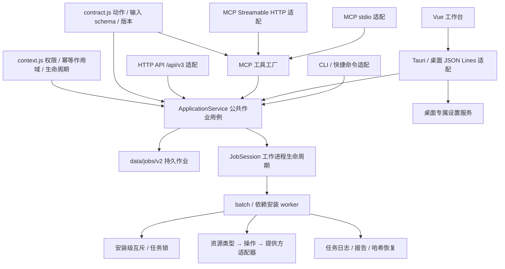

# 统一应用接口

状态：已实现应用契约 `/3`。源码：`resource-core/application/{contract,context,service,job-session}.js`。决策见 [ADR 0011](../decisions/0011-unified-application.md)；传输配置见[自动化接入](automation.md)和 [HTTP](http.md)。

## 分层与调用关系

公共业务只在 ApplicationService 实现：请求规范化、目录授权、依赖预检、幂等提交、作业查询、取消、任务列表和结果分页。`dispatch()` 不按 desktop/CLI/MCP/HTTP 分支；JobSession 只接收已经校验并登记的作业，不定义另一套请求、临时 ID 或校验流程。

入口只解析参数、处理传输认证、转换消息或等待结果。CLI 快捷命令也调用公共 submit；`batch.js` 是内部 worker，不再提供 `--resume/--restore` 用户命令。桌面通过同一 submit/status/cancel/results，配置保存等专属命令在 `desktop-actions.js`，不能启动或直接轮询工作进程。

## 公共契约与标识

`contract.js` 是十个动作及输入 JSON Schema 的唯一声明；MCP 用 Zod 从该声明生成 SDK schema。`capabilities` 同时返回操作/提供方参数和 inputSchemas。跨字段与文件系统检查由应用服务及原有引擎负责。完整动作和请求字段见[自动化契约](automation.md#统一动作)。

- 提交统一为 `{request,idempotencyKey}`，返回 `{jobId,replayed}`；CLI 等待后另带同一 status 的 state。
- jobId 是 64 位十六进制字符串，表示一次执行；taskId 表示可续跑/恢复的素材任务。公共输入和输出不含内部 taskFile，状态以 hasReport 表示报告存在。
- 状态只有工作进程退出后才最终 done；所有入口读取同一记录。恢复明细通过 results 分页读取，恢复执行必须传非空、带哈希的 selection。
- 桌面任务列表和恢复清单取完分页；音频面板最多展示前 100 条，完整结果仍可分页读取。打开报告只把 jobId 交给受信任服务验证，前端不提供路径。
- JSON 响应为 `asset-toolbox.response/3`；桌面 JSON Lines 另加关联 id，Rust 核对版本后解包；MCP 用 structuredContent/text 包装同一响应。参数拒绝用统一错误码，MCP SDK 的协议/schema 错误保持协议格式。

## 上下文、权限与生命周期

上下文只能由启动代码通过 `localContext()` 或 `policyContext()` 创建，构造函数拒绝任意对象；请求字段不能选择上下文。配置一经加载即冻结。

| 上下文属性 | 行为 |
| --- | --- |
| 本地权限 | 桌面及显式 `--local`/快捷 CLI，由本机操作者授权目录；保留引擎的文件保护与音频保留原文件要求 |
| policy 权限 | CLI Agent、stdio MCP、HTTP/MCP HTTP 固定目录根及覆盖/恢复/安装许可；读取、取消和结果查询也重新授权 |
| connection 生命周期 | 桌面、CLI、stdio MCP 的拥有进程退出或断连时，在文件边界取消自己启动的活动作业 |
| server 生命周期 | HTTP 请求/客户端断开不取消；正常停止服务时才取消该服务拥有的活动作业 |
| settings 能力 | 仅桌面上下文启用；HTTP 拒绝本地权限或 connection 上下文 |

关闭一个仅查询了他人作业的上下文不会取消该作业；显式 cancel 在授权范围内可跨入口执行。强杀进程依赖既有 INTERRUPTED/日志恢复，不承诺后台继续或整批回滚。

## 持久化与跨入口访问

所有入口使用 `data/jobs/v2/<jobId>/`，记录 `asset-toolbox.job/2`、规范化请求、进程和状态、取消标记。幂等键按权限上下文划分作用域：相同 policy 的各入口共用作用域；桌面与本地 CLI 共用本地作用域。权限变化产生不同幂等作用域，不能借此自动重新执行旧任务。

作业可见性由当前权限对原请求重新授权决定，不按提交入口隔离。授权覆盖该请求的 CLI/HTTP 可查询桌面作业；范围不足则返回 PATH_FORBIDDEN/PERMISSION_DENIED，列表过滤不可见记录。不是多用户租户系统，也不是 OS 沙箱。同一安装仍串行执行，未增加队列或定时清理；受信任本地上下文可手动维护旧明细。

## 版本与验证

应用接口与响应升级 `/3`，HTTP 路径为 `/api/v3/`；`/api/v1/`、`/api/v2/` 返回 410/UNSUPPORTED_VERSION。持久 job/2 及 data/jobs/v2 保持不变。旧 `data/automation/` 不读写、不迁移；新目录内出现 job/1 明确拒绝。旧桌面 start/poll 命令停用，必须配套新 EXE 和核心。素材 task/report `/1`、settings `/2`、提供方契约不变。

验证：核心 `unified.test.js` 覆盖上下文不可注入、生命周期与所有权、越权过滤、版本拒绝；MCP `http.test.mjs` 使用真实五种入口比较 schema、错误、状态、取消/续跑和分页结果；原生 E2E 比较新 EXE 与 CLI 的状态，并验证重启后仍能查询同一 jobId。结果见[项目状态](../project-status.md)。

## 存储维护与结果过期

`storage-preview/storage-clean` 调用共享存储维护模块，只有无 policy 的受信任本地上下文可以执行；目录授权不等于全局清理权。默认保留 30 天，必须预览并显式选择。清理后 status 保留最终摘要，返回 resultsExpired/cleanedAt，hasReport 为 false；results 和打开报告返回 RESULTS_EXPIRED。幂等重放仍返回原作业，不再次执行；任务和备份可继续恢复。详细范围、摘要/锁及中断行为见[存储维护](storage.md)和 [ADR 0012](../decisions/0012-storage-retention-and-test-layers.md)。

桌面已接入公共查询与取消，观察生命周期独立于执行所有者；未增加 API 或存储版本。跨会话执行竞争、串行队列与有限并行的比较见[统一作业中心与入口冲突](job-center.md)。
