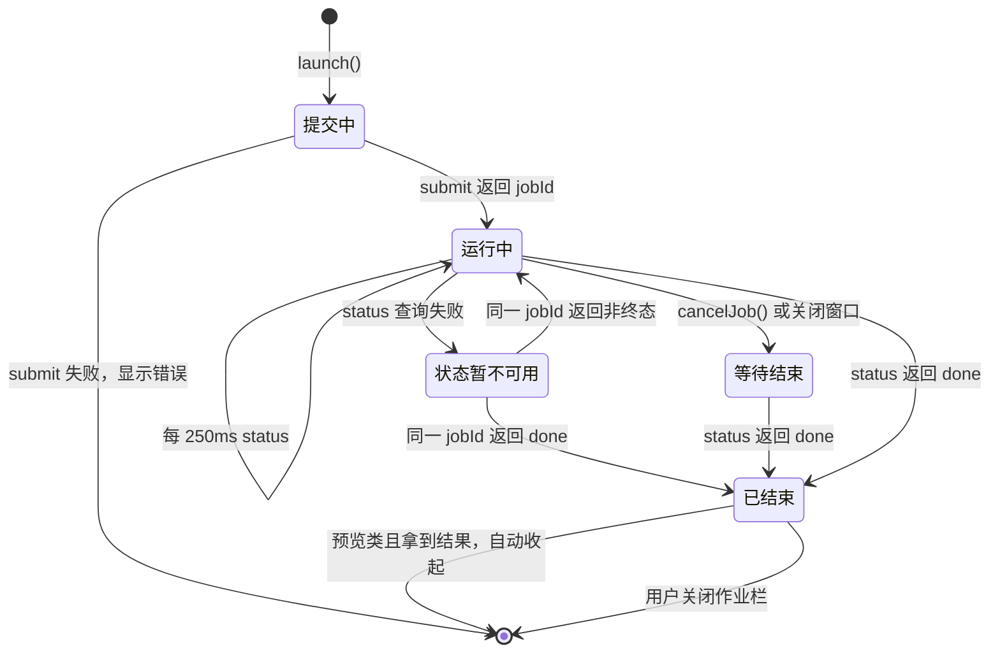

# 前端架构

有限并行状态与等待原因见[队列专题](queue.md)。原生宿主正常退出时关闭桥接输入并等待其取消、收尾全部自有作业，完成前拒绝新调用和重复退出；观察其他入口作业仍不接管所有权。

源码位于 `desktop/src/`。Vue 3 Composition API，TypeScript 严格模式，无路由库和全局状态库。视觉、布局、文案规则见[前端设计规范](../design/frontend-design.md)；本页说明代码结构、状态流转和与核心的请求映射。

## 源码结构

| 路径 | 职责 |
| --- | --- |
| `main.ts` | 挂载应用，引入全局样式，初始化外观；生产构建屏蔽浏览器右键菜单与刷新类快捷键 |
| `App.vue` | 窗口外壳：标题栏、活动栏、信息条、当前工作区、作业栏、状态栏；注册原生关闭事件和全局快捷键 |
| `core/types.ts` | 与桥接协议一一对应的类型 |
| `core/api.ts` | 唯一调用 Tauri 的位置：`core_call`、目录对话框、打开报告、打开获取页面 |
| `core/model.ts` | 纯函数：请求构造、可添加步骤按操作分组、步骤生成与切换、格式化、恢复勾选、任务状态 |
| `core/workbench.ts` | 工作台状态与全部动作：初始化、配置、作业生命周期、处理/任务/恢复操作 |
| `core/theme.ts` | 外观：浅色 / 深色，默认跟随系统，一次点击切换；写入 `<html data-theme>` 并保存到 `localStorage` |
| `core/preview-core.ts` | 仅浏览器调试使用的模拟核心，生产构建不包含 |
| `views/ProcessView.vue` | 处理页：命令栏 + 处理线 + 站点编辑器 |
| `views/ActivityView.vue` | 活动工作区：顶部分段选择在 `TasksView`（任务）与 `JobsView`（作业队列）之间切换；`page` 仍取 `tasks` / `jobs` |
| `views/TasksView.vue` | 任务视图：任务列表与详情（进度、体积统计、可打开的来源/写入/备份文件夹、备份与恢复） |
| `views/RestoreView.vue` | 恢复页：选择备份来源并检查 |
| `views/ToolsView.vue` | 工具页：处理工具可用性、获取渠道、识别类型 |
| `components/TitleBar.vue` | 自绘标题栏：拖动区域与最小化、最大化、关闭；没有原生窗口时只显示标题 |
| `components/Icon.vue` | 自绘的单色线条图标 |
| `components/SelectBox.vue` | 下拉选择：平铺用 Reka Select，分组用递归 DropdownMenu；接口为 `modelValue`、`options`、`id`、`disabled`、`placeholder` |
| `components/Tip.vue` | 提示：封装 Reka UI 的 Tooltip，接口为 `text`、`shortcut`、`side` |
| `components/ConfirmDialog.vue` | 确认对话框：封装 Reka UI 的 AlertDialog，显示 `bench.confirmation`，在 `App.vue` 中挂载一次 |
| `components/StepMenu.vue` | 处理线步骤的右键菜单：封装 Reka UI 的 ContextMenu，只发出 `select`、`move`、`toggle`、`remove` 事件 |
| `components/PipelineRail.vue` | 处理线与“资源分组 → 资源格式 → 操作”三级步骤选择器、搜索与键盘导航 |
| `components/StepEditor.vue` | 单个步骤：启用、排序与删除命令、组合、两组参数 |
| `components/ParameterFields.vue` | 按字段描述渲染参数控件 |
| `components/PathField.vue` | 路径输入与原生选择 |
| `components/RunInspector.vue` | 处理页右侧的概览栏：当前作业、扫描数字、各资源格式的步骤数与文件数 |
| `components/RestoreTable.vue` | 恢复检查结果的筛选、搜索、勾选、分页 |
| `components/JobDock.vue` | 作业栏：处理页以 `panel` 变体放在概览栏里，其他页面停靠在工作区底部 |
| `components/NumberField.vue` | 数值输入：数字框、步进按钮，范围有限时带滑块；由 `ParameterFields` 按字段描述使用 |
| `styles/tokens.css`、`styles/base.css` | 浅色与深色设计令牌、共享控件；组件布局写在各自的 scoped 样式中 |

## 工作台状态

`App.vue` 调用 `createWorkbench()` 并通过 `provide(workbenchKey)` 交给所有视图，视图用 `useWorkbench()` 取得。每次挂载 App 创建一份新状态，组件测试因此互不影响。

| 状态 | 说明 |
| --- | --- |
| `page` | 当前工作区：`process` / `tasks` / `restore` / `tools` |
| `boot`、`config`、`definition` | `bootstrap` 结果；`config` 是可编辑副本，先复制原始响应再放进响应式状态 |
| `station` | 处理线选中的站点：`source`、`output`、`scan` 或 `step:<步骤 ID>` |
| `scan`、`scanStale` | 最近一次扫描结果；当前配置生成的请求与扫描时不同即视为过期 |
| `tasks`、`selectedTaskId` | 任务摘要与任务页选中项 |
| `restoreForm`、`restorePreview`、`restoreScope`、`restoreChoices` | 当前恢复表单、对应的检查结果、默认范围与用户显式勾选 |
| `job`、`submitting`、`closing` | 当前作业、submit 请求进行中、窗口正在安全关闭 |
| `missingProviders`、`blockedSteps` | 缺依赖的工具；启用了缺依赖工具的步骤 |

处理页命令栏根据当前配置实时显示写入策略，点击只切换到 `output` 站点，不保存配置或启动作业；缺依赖入口只切换到工具页。`stepGroups()` 按目录顺序收集有提供方支持的操作及资源类型，同一组合跨提供方去重，不硬编码内置功能或过滤缺依赖工具。`PipelineRail` 从有效组合提取类别、该类格式及所选格式可用的操作，只维护层级与搜索状态，最后选择操作才调用 `bench.addStep()`；取消、搜索和返回不会修改配置。新步骤的参数默认值、提供方选择及保留原文件策略仍由既有模型和工作台决定。定位、焦点与关闭规则见[设计规范](../design/frontend-design.md#处理线站点)。容器查询负责步骤表单布局，不参与核心参数转换。

## 窗口外壳

- 原生窗口在 `tauri.conf.json` 中设为 `decorations: false`。`TitleBar.vue` 通过 `data-tauri-drag-region` 提供拖动与双击最大化，按钮调用 `getCurrentWindow()` 的 `minimize()`、`toggleMaximize()`、`close()`，并监听 `onResized` 同步最大化图标。所需权限在 `capabilities/default.json`：`start-dragging`、`minimize`、`toggle-maximize`、`internal-toggle-maximize`、`is-maximized`，以及原有的 `close`、`destroy`。
- 标题栏关闭按钮调用 `close()`，会触发 `onCloseRequested`，与系统关闭走同一条“先协作取消、再退出”的路径。
- `'__TAURI_INTERNALS__' in window` 为假时（浏览器调试、组件测试）不渲染窗口按钮。
- 状态栏的内容全部由工作台状态派生：`loading`、`closing`、`busy`、`job.title`、`tasks` 中 `canResume` 的数量、`missingProviders`。它不发起请求。
- 全局快捷键在 `App.vue` 的 `keydown` 监听中处理：`Ctrl+1`–`4` 调用与活动栏相同的 `go()`；`Ctrl+S` 仅在处理页且不忙时调用 `saveConfig()`。
- 外观状态是模块级的（`core/theme.ts`），不属于工作台；它只改 `<html data-theme>`，不影响任何请求。

视图不直接调用 `call('submit')`。所有作业都经 `launch(request, kind, title, onDone)` 启动。

## 作业生命周期

- `busy` 为真（提交中或作业未结束）时，所有会改变配置或启动作业的控件停用；导航、查看和取消仍可用。
- 在 submit 返回前点击取消会记录待取消，拿到 ID 后立即发送 `cancel`。
- `status` 失败时，`ActiveJob` 保留 jobId、上次成功的进度和取消意图。状态查询依次等待 0.5、1、2、4 秒后重试，持续失败则保持 4 秒间隔，恢复后回到正常频率。工作台卸载时停止轮询并忽略晚到响应。
- 核心确认 `done` 后立即显示其终态。恢复清单全部分页成功后才发布到恢复表，音频报告按需读取前 100 条。`results` 失败时保留终态与作业栏，用户可按同一 ID 重新读取。关闭卡片或启动新作业后，迟到的旧结果无法调用新作业的回调。
- 关闭窗口时向在途作业申请取消。若发送失败，在再次取得非终态时向原 ID 重发；核心确认终态后才继续关窗。结果明细读取失败不阻止已结束作业退出。
- 作业在任何页面都显示，直到用户关闭：处理页（配置与目录可用时）由 `ProcessView` 里的概览栏渲染 `JobDock variant="panel"`，其余情况由 `App.vue` 在工作区底部渲染；两处条件互斥，同一时刻只有一个 `.dock`。关闭只清除前端状态，不删除任务或报告。
- **拖入来源**：`core/api.ts` 的 `onFolderDrop` 封装 Tauri 的 `onDragDropEvent`，`ProcessView` 在挂载期间监听；松开后调用工作台的 `useDroppedSource`，它先用原生命令 `is_directory`（只读判断路径是否为现有文件夹）校验第一个路径，再写入 `config.sourceDir`。作业运行时忽略拖入。

## 请求映射

| 界面动作 | 请求 | 说明 |
| --- | --- | --- |
| 启动 | `bootstrap`、`tasks` | 处理配置加载失败时仍可使用任务和恢复 |
| 保存配置 | `save` | 成功后用返回值替换当前配置 |
| 扫描预览 | `normalize` → `submit {request: {mode:'preview'}}` | 不保存配置；结果写入 `scan`，显示在概览栏；选中的站点不变 |
| 开始处理 | `normalize` → `save` → `submit {request: {mode:'process'}}` | 保存失败显示提示，但本次仍处理 |
| 刷新依赖状态 | `providers` | 只替换目录中的工具列表，不重置配置 |
| 打开获取页面 | 原生 `open_provider_source({id})` | 前端只传 ID，地址由核心解析 |
| 获取安装 / 更新 / 修复 / 重装 | `submit {request: {mode:'dependency-install', providerId}}` | 前端不传地址、摘要或路径；复用作业栏，结束后刷新 providers，保留当前配置 |
| 继续未完成 / 重试失败项 | `submit {request: {mode:'resume'/'retry', taskId}}` | 不使用当前表单 |
| 检查备份（任务） | `submit {request: {mode:'restore-preview', taskId}}` | 继续上次恢复、重试恢复失败项同样请求，只是默认勾选范围不同 |
| 检查独立备份 | `submit {request: {mode:'restore-export-preview', backupDir, outputDir}}` | 两个路径都必填 |
| 恢复所选 | `submit {request: {mode:'restore' 或 'restore-export', …, selection}}` | 始终显式传 `{path, backupHash, targetHash}` 数组，空选择不能提交 |
| 取消 | `cancel {jobId}` | 协作取消，在文件边界生效 |
| 打开报告 | 原生 `open_report({id})` | Rust 校验报告目录属于本次作业 |
| 打开任务文件夹 | 原生 `open_folder({path})` | 路径来自核心返回的任务摘要；Rust 只接受绝对路径且必须是现有文件夹，否则返回错误，由工作台显示 |

`processingRequest()` 负责把配置转换为请求：去除路径首尾空白和引号；另存只传 `outputDir`；覆盖且启用备份才传 `backupDir`；缺少必填路径时在发送前报错。

## 步骤编辑

- 添加步骤从目录的有效类型/操作组合（`stepGroups`）依次生成资源分组、资源格式与操作，最后用默认工具和默认参数创建步骤并选中它。最多 64 步。
- 步骤编辑器从 `provider.adapters` 中按当前 operation 读取专属 fields，`providerOptions` 只含该操作的工具参数；公共字段仍由操作定义提供。
- `retargetStep` 在操作 ID 相同时复制保留公共参数，专属参数使用目标适配器默认值；跨操作则重置两组。保留步骤 ID 和启用状态，清除旧版本快照，由核心重新校验并填充；切换回原工具不会恢复此前的专属参数。
- “恢复默认参数”只重置当前步骤的参数（`resetStep`），不改变组合、顺序和启用状态。
- 停用的步骤仍保存参数，参数控件只读。数值框清空时暂存空串，由核心在 `normalize` 时拒绝。
- 删除步骤后选中相邻步骤；没有步骤时回到“来源”。

## 恢复勾选

工作台将检查结果绑定到当前恢复模式和任务 ID，独立导出则绑定到备份、目标两个目录。改选会立即移除结果与勾选，晚到的旧结果和旧表格的提交事件会被丢弃。保持同一来源时，跨页返回和重新检查均保留显式勾选，恢复使用最新检查的可选状态及哈希。取消的检查只读。表格内的搜索与状态筛选只影响显示，仍会提示隐藏的勾选数。

活动页任务搜索同时约束列表、详情和操作按钮。选中项被筛掉时展示首个匹配任务，零匹配时收起详情。清空搜索后回到最近一次明确选择的任务。

## 下拉选择与提示的封装

- 视图不直接引入 `reka-ui`。`SelectBox` 的平铺 `options` 用 Reka Select，含分组时用非模态 DropdownMenu，`SelectMenuItems` 递归渲染分支和 RadioItem 叶子。`core/select-options.ts` 定义递归条目并展平查询当前标签，未挂载的子菜单也能显示当前值。分组只展开，叶子才发 `update:modelValue`；禁用时关闭菜单；空字符串视为“未选择”，改用占位文字。触发按钮透传 `id`、`class`、`aria-label`，所以 `<label for>` 和按类名定位仍然有效。
- 弹出列表和提示由 Reka 通过 Teleport 挂到 `body`，不在组件的 scoped 样式作用域内，样式统一写在 `styles/base.css`。父组件要调整触发按钮的布局时用 `:deep()` 或 `base.css` 中的共享规则。
- `Tip` 自带 `TooltipProvider`，单独挂载的组件（包括组件测试）不需要额外的提供者。它用 `as-child` 把行为加到插槽里的控件上，不增加 DOM 层级，因此不影响已有的选择器。
- 组件测试（jsdom）不模拟指针与浮层交互：用 `tests/select.ts` 的 `selectBox()`、`choose()`、`optionLabels()` 通过 `SelectBox` 的公开接口验证本项目的逻辑。原生 E2E 用 `tests/native-select.ts` 的 `pickOption(page, scope, 标签, 核心ID)` 逐级真实点选，叶子通过 `role="option"` 或 `role="menuitemradio"` 与 `data-value` 定位，分支的 `data-values` 仅供测试定位其后代 ID。过滤原生用例另外直接验证左右方向键、Esc 与焦点归还。

## 确认、右键菜单与步骤排序

- **确认**：`bench.confirm(request)` 返回 `Promise<boolean>`，把请求放进 `bench.confirmation`；`ConfirmDialog` 显示它并调用 `bench.answerConfirmation()`。新请求到来时，尚未回答的旧请求按取消处理。取消（按钮或 Esc）经 Reka 的 `update:open` 统一处理；确认按钮是普通按钮，先回答再关闭，避免关闭事件抢先把它判为取消。
- `requestRemoveStep(index)` 确认后按步骤 ID 重新定位再删除，等待期间步骤被移动或作业开始都不会误删。`requestProcess()` 仅在“覆盖原文件且未启用备份”时先确认，然后调用 `runPipeline('process')`；取消时不保存配置、不提交作业。视图里的删除与开始处理都走这两个函数，不直接调用 `removeStep` / `runPipeline('process')`。
- **右键菜单**：`StepMenu` 用 `as-child` 把行为加到步骤按钮上，不增加 DOM 层级。菜单项只发事件，移动、启停、删除仍由工作台的 `moveStep`、`toggleStep`（经 `updateStep`，保留受保护操作改为另存的规则）、`requestRemoveStep` 执行。
- **拖拽排序**：`PipelineRail` 在步骤按钮 `pointerdown` 时开始监听 `window` 的 `pointermove` / `pointerup`（不使用指针捕获，因为重排会移动 DOM 节点）。移动超过阈值后，按指针越过了哪个步骤的中线计算目标位置并调用 `bench.moveStepTo(from, to)`，列表实时重排。松开后吞掉紧随其后的那一次 `click`，下一轮事件循环即撤销这个拦截。没有使用 HTML5 拖放，所以不需要改动 Tauri 的拖放设置。
- **添加步骤选择器的定位**：`@floating-ui/dom` 的 `computePosition`（`fixed` 策略，`offset`、`flip`、`shift`、`size`）。选择器本身仍是项目自己的实现，留在处理线的 DOM 里，没有迁移到 Reka。

## 验证

| 层级 | 文件 | 覆盖 |
| --- | --- | --- |
| 组件与模型 | `desktop/tests/ui.test.ts` | 动态参数及命名空间、组合切换、停用只读、缺依赖提示、数值越界提示、数值控件的步进/夹取/取整与滑块条件；恢复筛选与勾选、范围预选、取消后只读；工具页渠道与刷新；请求构造、体积格式、操作分组与去重、任务状态 |
| 应用流程 | `desktop/tests/app.test.ts` | 扫描结果留在概览栏与过期、处理页作业卡片与底部作业栏互斥、拖入来源与非文件夹拒绝、来源落地区、跨页取消、作业栏持久与关闭、预览错误、缺依赖拦截、三级步骤选择/搜索/返回/焦点/关闭、排序与删除步骤、续跑与重试请求、任务恢复与独立备份请求、活动页的视图切换与记忆、任务体积统计与打开文件夹、恢复页选中即检查、快捷键与状态栏、外观切换 |
| 原生 | `desktop/tests/native.spec.ts` | 构建后的 EXE：工具缺失与恢复、动态扩展参数、选择器在 1220×850/840×620（视口尺寸；窗口默认 1280×850） 和浅色/深色下的边界及截图、键盘添加、扫描、另存、覆盖备份、跨页取消、续跑、重试、选择性恢复、真实图片缩放、配置重启、运行中关闭 |

测试只依赖语义选择器、`data-station`、`data-step-id`、`data-provider-id`、作业栏的 `data-job-id`、`data-state`，以及少量结构类名（`nav.tabs`、`.rail`、`.adder`、`.choice`、`.editor`、`.runbar`、`.summary-link`、`.dock`、`.inspector`、`.statusbar`、`.restore-table .foot`、工具行的 `.state`）。调整样式类名时保持这些钩子。原生窗口的拖动、缩放与窗口按钮无法由 CDP 测试覆盖，改动标题栏后需要人工核对。截图保存在 `desktop/test-results/`，不提交。

## 音频操作与结果

目录 API 4 驱动新增音频组合，无独立硬编码参数表单；同操作跨工具公共参数保留规则不变。workbench.updateStep/addStep 为 preserveOriginal 操作默认选择另存，processingRequest 与核心同时拒绝无备份覆盖。只有 observe 时请求省略记忆中的目标路径，写入摘要显示“仅分析，不写入素材”。

JobDock 中 AudioResults 展示前 100 条步骤测量、请求/实际增益、是否达标和峰值警告，null 明确显示不可测，失败文件标注未提交。完整结果从报告打开；作业栏限制高度并允许内部滚动。原生测试见 audio.spec.ts。

公共调用使用应用 /8；上表 submit 的输入还必填 idempotencyKey，由前端为每次明确提交生成 UUID。所有任务选中值和续跑/恢复参数使用 taskId，任务列表与恢复 results 取完分页；音频完成后从 results 获取前 100 条。状态用 hasReport，原生打开报告按 jobId 由应用服务核验。旧 start/poll 与 taskFile 不再发送，见[统一应用接口](application.md)。

## 存储维护面板

工具页的 `StorageMaintenance.vue` 负责天数、分页和显式选择；默认 30 天、折叠、不勾选。`workbench.ts` 调用公共 storage-preview/storage-clean，维护独立 maintenanceBusy 并纳入 busy；期间禁止其他操作，关闭窗口等待维护结束。修改天数使预览失效，翻页清空选择；STALE_PREVIEW 清除旧预览且不自动重试。清理后刷新状态，JobDock 对 resultsExpired 显示明细已清理。浏览器预览仅展示空清单，不模拟删除。参见[存储维护](storage.md)。

## Agent 接入与服务管理

工具页的 `ServicePanel.vue` 调用公共五个 service-* 动作，表单按服务状态禁用，打开面板时读取配置，每 2 秒刷新状态；卸载只取消观察定时器。连接 JSON 可复制，令牌正文不显示。浏览器预览仅模拟状态；生命周期、管理授权及 stdio 宿主启动规则见[服务管理](service-management.md)。

## 属性过滤编辑

分类由 `core/resource-groups.ts` 根据核心 `resourceTypes[].kind` 生成，统一用于工具、来源、扫描和步骤选择。图片/音频排序固定，格式保留目录顺序，未知 kind 保留可见；扫描的未知格式放“其他”组。类别只负责界面组织，一个步骤仍对应一个明确格式，未增加跨格式步骤或改变任务/适配器契约。过滤器的类别和格式选项显示中文，值仍发送 image/audio/jpg/png 等核心 ID。

属性菜单按代码目录的 group 分层为通用文件属性、图片属性等，通用组优先；格式值与步骤格式统一使用“类别 → 格式”子菜单。比较符、布尔值、操作和提供方等短列表保持单层。

来源页与 StepEditor 共用 `FilterEditor.vue`：目录提供属性类型、适用资源、单位及运算符，界面只构造 sourceFilter/step.filter。支持组内“且”、组间“或”、删除和清除，运行期间禁用。同类型切换工具保留规则，切换资源类型清空，重置操作参数不清空条件。扫描显示发现/来源排除数量，启用步骤仅表示配置范围；实际逐步 filtered 状态保存在公共 results/报告。完整语义见[属性与过滤器](properties-and-filters.md)。

## 统一作业中心

`JobsView.vue` / `core/job-center.ts` 调用公共 jobs/status/results/cancel。观察状态独立于 workbench 的 ActiveJob；不提交、不接管作业，页面卸载只停止刷新。Ctrl+5 打开作业工作区，原 Ctrl+1–4 不变。每页 20 个作业、50 条文件结果，2 秒刷新，本页搜索/状态筛选；已清理结果有独立提示。报告按 ID 打开，关联任务进入原任务页。详见[作业中心及冲突设计](job-center.md)。

公共 queue 提供独立于历史分页的活动快照，JobCard 展示固定编号槽位、等待项及历史项；同 ID 不重复出现在历史卡片中。scheduling-set 在空闲时设置 1–8 项并行，并支持一键采用 CPU 建议。后台公共接口 /8，桌面仍一次配置一个本会话作业，可与其他入口无冲突作业并行，资源冲突或槽位满时排队。配置错误不推测新预算，查询失败清除旧配置入口；布局和交互见[设计规范](../design/frontend-design.md#作业工作区)。
