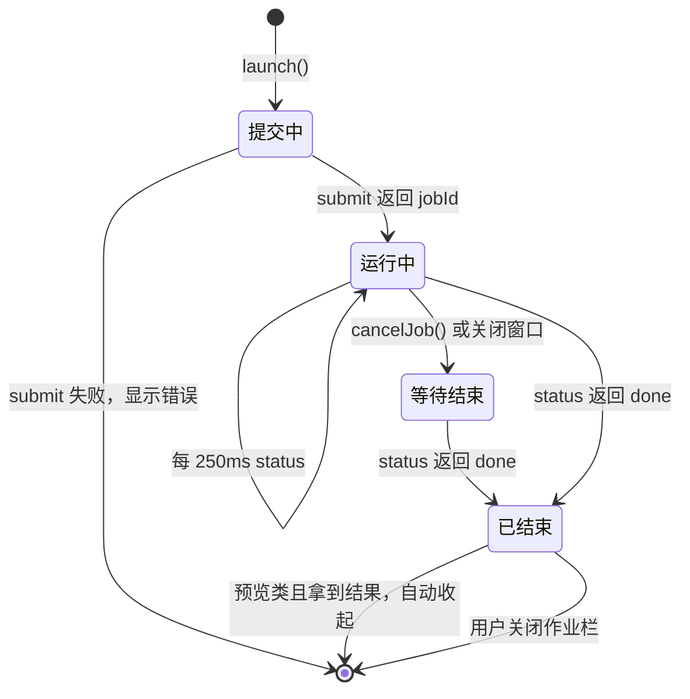

# 前端架构

源码位于 `desktop/src/`。Vue 3 Composition API，TypeScript 严格模式，无路由库和全局状态库。视觉、布局、文案规则见[前端设计规范](../design/frontend-design.md)；本页说明代码结构、状态流转和与核心的请求映射。

## 源码结构

| 路径 | 职责 |
| --- | --- |
| `main.ts` | 挂载应用，引入全局样式，初始化外观；生产构建屏蔽浏览器右键菜单与刷新类快捷键 |
| `App.vue` | 窗口外壳：标题栏、活动栏、信息条、当前工作区、作业栏、状态栏；注册原生关闭事件和全局快捷键 |
| `core/types.ts` | 与桥接协议一一对应的类型 |
| `core/api.ts` | 唯一调用 Tauri 的位置：`core_call`、目录对话框、打开报告、打开获取页面 |
| `core/model.ts` | 纯函数：请求构造、可添加步骤按操作分组、步骤生成与切换、格式化、恢复勾选、任务状态 |
| `core/workbench.ts` | 工作台状态与全部动作：初始化、配置、作业生命周期、处理/任务/恢复操作 |
| `core/theme.ts` | 外观：浅色 / 深色，默认跟随系统，一次点击切换；写入 `<html data-theme>` 并保存到 `localStorage` |
| `core/preview-core.ts` | 仅浏览器调试使用的模拟核心，生产构建不包含 |
| `views/ProcessView.vue` | 处理页：命令栏 + 处理线 + 站点编辑器 |
| `views/TasksView.vue` | 任务页：任务列表与详情 |
| `views/RestoreView.vue` | 恢复页：选择备份来源并检查 |
| `views/ToolsView.vue` | 工具页：处理工具可用性、获取渠道、识别类型 |
| `components/TitleBar.vue` | 自绘标题栏：拖动区域与最小化、最大化、关闭；没有原生窗口时只显示标题 |
| `components/Icon.vue` | 自绘的单色线条图标 |
| `components/PipelineRail.vue` | 处理线与“操作 → 资源类型”两级步骤选择器、搜索与键盘导航 |
| `components/StepEditor.vue` | 单个步骤：启用、排序与删除命令、组合、两组参数 |
| `components/ParameterFields.vue` | 按字段描述渲染参数控件 |
| `components/PathField.vue` | 路径输入与原生选择 |
| `components/ScanSummary.vue` | 扫描结果 |
| `components/RestoreTable.vue` | 恢复检查结果的筛选、搜索、勾选、分页 |
| `components/JobDock.vue` | 底部作业栏 |
| `styles/tokens.css`、`styles/base.css` | 浅色与深色设计令牌、共享控件；组件布局写在各自的 scoped 样式中 |

## 工作台状态

`App.vue` 调用 `createWorkbench()` 并通过 `provide(workbenchKey)` 交给所有视图，视图用 `useWorkbench()` 取得。每次挂载 App 创建一份新状态，组件测试因此互不影响。

| 状态 | 说明 |
| --- | --- |
| `page` | 当前工作区：`process` / `tasks` / `restore` / `tools` |
| `boot`、`config`、`definition` | `bootstrap` 结果；`config` 是可编辑副本，先复制原始响应再放进响应式状态 |
| `station` | 处理线选中的站点：`source`、`output`、`scan` 或 `step:<步骤 ID>` |
| `scan`、`scanStale` | 最近一次扫描结果；当前配置生成的请求与扫描时不同即视为过期 |
| `tasks`、`selectedTaskId` | 任务摘要与任务页选中项 |
| `restoreSource`、`restorePreview`、`restoreScope` | 恢复来源（任务或独立备份）、检查结果、默认勾选范围 |
| `job`、`submitting`、`closing` | 当前作业、submit 请求进行中、窗口正在安全关闭 |
| `missingProviders`、`blockedSteps` | 缺依赖的工具；启用了缺依赖工具的步骤 |

处理页命令栏根据当前配置实时显示写入策略，点击只切换到 `output` 站点，不保存配置或启动作业；缺依赖入口只切换到工具页。`stepGroups()` 按目录顺序收集有提供方支持的操作及资源类型，同一组合跨提供方去重，不硬编码内置功能或过滤缺依赖工具。`PipelineRail` 只维护选择器层级与搜索状态，选择资源类型后才调用 `bench.addStep()`；取消、搜索和返回不会修改配置。新步骤的参数默认值、提供方选择及保留原文件策略仍由既有模型和工作台决定。定位、焦点与关闭规则见[设计规范](../design/frontend-design.md#处理线站点)。容器查询负责步骤表单布局，不参与核心参数转换。

## 窗口外壳

- 原生窗口在 `tauri.conf.json` 中设为 `decorations: false`。`TitleBar.vue` 通过 `data-tauri-drag-region` 提供拖动与双击最大化，按钮调用 `getCurrentWindow()` 的 `minimize()`、`toggleMaximize()`、`close()`，并监听 `onResized` 同步最大化图标。所需权限在 `capabilities/default.json`：`start-dragging`、`minimize`、`toggle-maximize`、`internal-toggle-maximize`、`is-maximized`，以及原有的 `close`、`destroy`。
- 标题栏关闭按钮调用 `close()`，会触发 `onCloseRequested`，与系统关闭走同一条“先协作取消、再退出”的路径。
- `'__TAURI_INTERNALS__' in window` 为假时（浏览器调试、组件测试）不渲染窗口按钮。
- 状态栏的内容全部由工作台状态派生：`loading`、`closing`、`busy`、`job.title`、`tasks` 中 `canResume` 的数量、`missingProviders`。它不发起请求。
- 全局快捷键在 `App.vue` 的 `keydown` 监听中处理：`Ctrl+1`–`4` 调用与活动栏相同的 `go()`；`Ctrl+S` 仅在处理页且不忙时调用 `saveConfig()`。
- 外观状态是模块级的（`core/theme.ts`），不属于工作台；它只改 `<html data-theme>`，不影响任何请求。

视图不直接调用 `call('submit')`。所有作业都经 `launch(request, kind, title, onDone)` 启动。

## 作业生命周期

- `busy` 为真（提交中或作业未结束）时，所有会改变配置或启动作业的控件停用；导航、查看和取消仍可用。
- 在 submit 返回前点击取消会记录待取消，拿到 ID 后立即发送 `cancel`。
- 作业结束后执行 `onDone` 回调并刷新任务列表。`preview` 和 `restore-check` 两类在 `state.preview` 存在时清除 `job`，结果由页面显示；出错时保留作业栏。
- 窗口关闭：有作业时阻止关闭，设 `closing` 并取消；status 收到 done 后再调用原生 `close()`。桥接保证工作进程已退出。
- 作业栏在任何页面都显示，直到用户关闭。关闭只清除前端状态，不删除任务或报告。

## 请求映射

| 界面动作 | 请求 | 说明 |
| --- | --- | --- |
| 启动 | `bootstrap`、`tasks` | 处理配置加载失败时仍可使用任务和恢复 |
| 保存配置 | `save` | 成功后用返回值替换当前配置 |
| 扫描预览 | `normalize` → `submit {request: {mode:'preview'}}` | 不保存配置；结果写入 `scan` 并选中“扫描结果”站点 |
| 开始处理 | `normalize` → `save` → `submit {request: {mode:'process'}}` | 保存失败显示提示，但本次仍处理 |
| 刷新依赖状态 | `providers` | 只替换目录中的工具列表，不重置配置 |
| 打开获取页面 | 原生 `open_provider_source({id})` | 前端只传 ID，地址由核心解析 |
| 获取安装 / 更新 / 修复 / 重装 | `submit {request: {mode:'dependency-install', providerId}}` | 前端不传地址、摘要或路径；复用作业栏，结束后刷新 providers，保留当前配置 |
| 继续未完成 / 重试失败项 | `submit {request: {mode:'resume'/'retry', taskId}}` | 不使用当前表单 |
| 检查备份（任务） | `submit {request: {mode:'restore-preview', taskId}}` | 继续上次恢复、重试恢复失败项同样请求，只是默认勾选范围不同 |
| 检查独立备份 | `submit {request: {mode:'restore-export-preview', backupDir, outputDir}}` | 两个路径都必填 |
| 恢复所选 | `submit {request: {mode:'restore' 或 'restore-export', …, selection}}` | 始终显式传 `{path, backupHash, targetHash}` 数组，空选择不能提交 |
| 取消 | `cancel {jobId}` | 协作取消，在文件边界生效 |
| 打开报告 | 原生 `open_report({id})` | Rust 校验报告目录属于本次作业 |

`processingRequest()` 负责把配置转换为请求：去除路径首尾空白和引号；另存只传 `outputDir`；覆盖且启用备份才传 `backupDir`；缺少必填路径时在发送前报错。

## 步骤编辑

- 添加步骤选择器按操作分组目录中受支持的资源类型（`stepGroups`），选定操作与类型后用默认工具和默认参数创建步骤并选中它。最多 64 步。
- 步骤编辑器从 `provider.adapters` 中按当前 operation 读取专属 fields，`providerOptions` 只含该操作的工具参数；公共字段仍由操作定义提供。
- `retargetStep` 在操作 ID 相同时复制保留公共参数，专属参数使用目标适配器默认值；跨操作则重置两组。保留步骤 ID 和启用状态，清除旧版本快照，由核心重新校验并填充；切换回原工具不会恢复此前的专属参数。
- “恢复默认参数”只重置当前步骤的参数（`resetStep`），不改变组合、顺序和启用状态。
- 停用的步骤仍保存参数，参数控件只读。数值框清空时暂存空串，由核心在 `normalize` 时拒绝。
- 删除步骤后选中相邻步骤；没有步骤时回到“来源”。

## 恢复勾选

`RestoreTable` 独立维护勾选集合。筛选和搜索只改变显示，被隐藏的已勾选项保留并提示数量。重新检查后，之前出现过的可选文件沿用用户勾选，新出现的文件按范围（全部 / 上次未完成 / 上次失败）默认勾选。冲突和已恢复文件不可勾选；检查被取消时整表只读。

## 验证

| 层级 | 文件 | 覆盖 |
| --- | --- | --- |
| 组件与模型 | `desktop/tests/ui.test.ts` | 动态参数及命名空间、组合切换、停用只读、缺依赖提示；恢复筛选与勾选、范围预选、取消后只读；工具页渠道与刷新；请求构造、体积格式、操作分组与去重、任务状态 |
| 应用流程 | `desktop/tests/app.test.ts` | 扫描结果归位与过期、跨页取消、作业栏持久与关闭、预览错误、缺依赖拦截、两级步骤选择/搜索/返回/焦点/关闭、排序与删除步骤、续跑与重试请求、任务恢复与独立备份请求、快捷键与状态栏、外观切换 |
| 原生 | `desktop/tests/native.spec.ts` | 构建后的 EXE：工具缺失与恢复、动态扩展参数、选择器在 1220×850/840×620 和浅色/深色下的边界及截图、键盘添加、扫描、另存、覆盖备份、跨页取消、续跑、重试、选择性恢复、真实图片缩放、配置重启、运行中关闭 |

测试只依赖语义选择器、`data-station`、`data-step-id`、`data-provider-id`、作业栏的 `data-job-id`、`data-state`，以及少量结构类名（`nav.tabs`、`.rail`、`.adder`、`.choice`、`.editor`、`.runbar`、`.summary-link`、`.dock`、`.statusbar`、`.restore-table .foot`、工具行的 `.state`）。调整样式类名时保持这些钩子。原生窗口的拖动、缩放与窗口按钮无法由 CDP 测试覆盖，改动标题栏后需要人工核对。截图保存在 `desktop/test-results/`，不提交。

## 音频操作与结果

目录 API 3 驱动新增音频组合，无独立硬编码参数表单；同操作跨工具公共参数保留规则不变。workbench.updateStep/addStep 为 preserveOriginal 操作默认选择另存，processingRequest 与核心同时拒绝无备份覆盖。只有 observe 时请求省略记忆中的目标路径，写入摘要显示“仅分析，不写入素材”。

JobDock 中 AudioResults 展示前 100 条步骤测量、请求/实际增益、是否达标和峰值警告，null 明确显示不可测，失败文件标注未提交。完整结果从报告打开；作业栏限制高度并允许内部滚动。原生测试见 audio.spec.ts。

公共调用使用应用 /3；上表 submit 的输入还必填 idempotencyKey，由前端为每次明确提交生成 UUID。所有任务选中值和续跑/恢复参数使用 taskId，任务列表与恢复 results 取完分页；音频完成后从 results 获取前 100 条。状态用 hasReport，原生打开报告按 jobId 由应用服务核验。旧 start/poll 与 taskFile 不再发送，见[统一应用接口](application.md)。

## 存储维护面板

工具页的 `StorageMaintenance.vue` 负责天数、分页和显式选择；默认 30 天、折叠、不勾选。`workbench.ts` 调用公共 storage-preview/storage-clean，维护独立 maintenanceBusy 并纳入 busy；期间禁止其他操作，关闭窗口等待维护结束。修改天数使预览失效，翻页清空选择；STALE_PREVIEW 清除旧预览且不自动重试。清理后刷新状态，JobDock 对 resultsExpired 显示明细已清理。浏览器预览仅展示空清单，不模拟删除。参见[存储维护](storage.md)。
