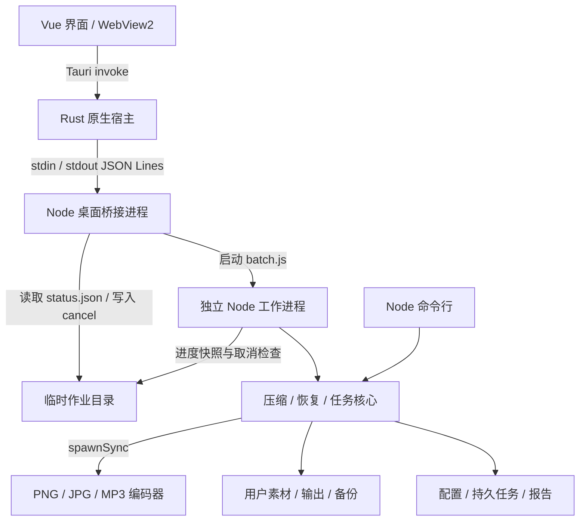

# 总体架构

本项目是面向 Windows 的便携资源处理工具 **AssetToolbox**，主要面向游戏资源，并逐步扩展图片、音频等处理能力。当前支持递归扫描、PNG/JPG/MP3 压缩、另存、覆盖备份、任务续压与选择性恢复；图片调整、音频编辑和多步骤流水线尚未实现。桌面包版本为 `2.0.0`。它使用本机进程和文件通信，没有应用 HTTP 后端、数据库、账户服务或云端处理。

## 技术层次与源码入口

| 层次 | 入口 | 职责 |
| --- | --- | --- |
| 界面 | `desktop/src/main.ts`、`App.vue` | Vue 3 Composition API、TypeScript、三个工作区与异步作业展示 |
| 原生宿主 | `desktop/src-tauri/src/main.rs` | Tauri 2、WebView2、目录选择、JSON Lines 桥接、打开报告 |
| 桌面会话 | `resource-core/desktop-bridge.js` | action 白名单、单作业调度、工作进程与临时文件生命周期 |
| 批处理编排 | `resource-core/batch.js` | 请求分流、进度、取消、持久任务锁、报告 |
| 业务核心 | `compress.js`、`restore.js`、`tasks.js`、`settings.js` | 编码、文件安全、恢复、事件日志及配置兼容 |
| 扩展模块 | `resource-core/processors/` | schema、格式识别、工具参数与编码器适配 |
| 公共机制 | `resource-core/framework/` | `registry.js` 发现模块，`schema.js`/`options.js` 编译与聚合参数，`process.js` 调用工具 |

以上 Node 文件均位于 `resource-core/`。核心只依赖 Node 标准库；前端 npm 依赖和 Rust crate 分别由 `package-lock.json`、`Cargo.lock` 锁定。Vite 负责前端构建，`vue-tsc` 负责严格类型检查。

## 进程关系

生产启动不监听网络端口。开发用 Vite 监听 `127.0.0.1:1420`；原生 E2E 显式设置测试变量后，WebView2 才开放本机 CDP 测试端口。Node 核心的同步 IO 和同步编码器放在工作进程内，桥接进程仍能响应轮询与取消。Rust 用 `spawn_blocking` 执行阻塞管道通信，`Mutex` 串行化请求。

## 从启动到完成

1. EXE 定位相邻 `resource-core/` 与 `runtime/node.exe`。调试模式还可回退到源码根目录。
2. 前端 `bootstrap` 加载公共/模块配置与动态字段，再通过 `tasks` 获取历史。模块错误不会阻止加载任务及恢复入口。
3. 新压缩先执行 `normalize`，再尝试 `save`，随后 `start`；预览仅规范化参数，不保存配置。
4. 桥接进程创建临时请求目录并启动工作进程。工作进程分派预览、压缩、续压、重试或恢复。
5. 压缩任务在完整扫描后固定清单，逐文件记录写入意图、提交结果，并生成本次报告。
6. 界面按 250 ms 间隔轮询。只有工作进程退出后，桥接层才向界面报告 `done`，防止锁未释放就启动下一次处理。
7. 取消在扫描期间或文件之间生效。当前文件的编码、校验及提交结束后停止；已完成结果保留。

## 两类任务标识

**作业会话**由桥接层生成 UUID，最多保留当前一个，关联临时 `request.json`、`status.json` 和 `cancel`。开始下一作业或退出桥接进程时清理已结束会话。

**持久任务**由 `tasks.js` 生成“时间戳 + UUID”，保存在 `resource-core/tasks/`。一次压缩任务可对应多次续压、重试和恢复作业；跨启动继续依赖 `taskFile`，不能复用旧会话 ID。扫描预览与旧备份导出不建立持久任务。

## 核心边界与设计取舍

- 模块 schema 同时驱动界面、CLI、默认值和校验，新增格式无需修改前端或 Rust。
- 文件改写前验证内容与路径；覆盖备份、日志和输出各有独立生命周期，不承诺整批事务回滚。
- UI 负责交互限制，Node 负责最终业务校验；TypeScript 接口不是运行时安全边界。
- 每个桥接实例只运行一个作业；不同实例通过持久任务锁避免同时操作同一任务。锁不是不同任务之间的全局素材锁。
- 模块是受信任的本地 JavaScript，拥有 Node 权限；自动发现不是插件沙箱。
- 文件内容与任务日志读入内存，编码串行进行；大文件、大任务性能需要单独测量。恢复表分页只减少 DOM 行数，不减少传输或内存中的完整清单。

## 便携发布边界

`npm run build` 将前端嵌入 Rust release EXE，并由 `portable.mjs` 放到项目根目录。移动应用需同时携带 EXE、`runtime/` 和 `resource-core/`，不需要 `node_modules`、`target` 或 `dist`。任务记录中的素材路径仍是绝对路径，移动工具不会自动重定位素材。

代码导航：[前端](frontend.md)、[后端](backend.md)、[协议](protocol.md)、[持久化](persistence.md)。设计取舍补录见 [ADR 0001](../decisions/0001-local-process-architecture.md)。

本次职责与目录调整见 [ADR 0002](../decisions/0002-resource-toolbox-layout.md)。未来的多操作模型及 Cordis 选型见[专项评估](../plans/resource-processing-and-cordis.md)，当前仍使用本地目录发现机制。
