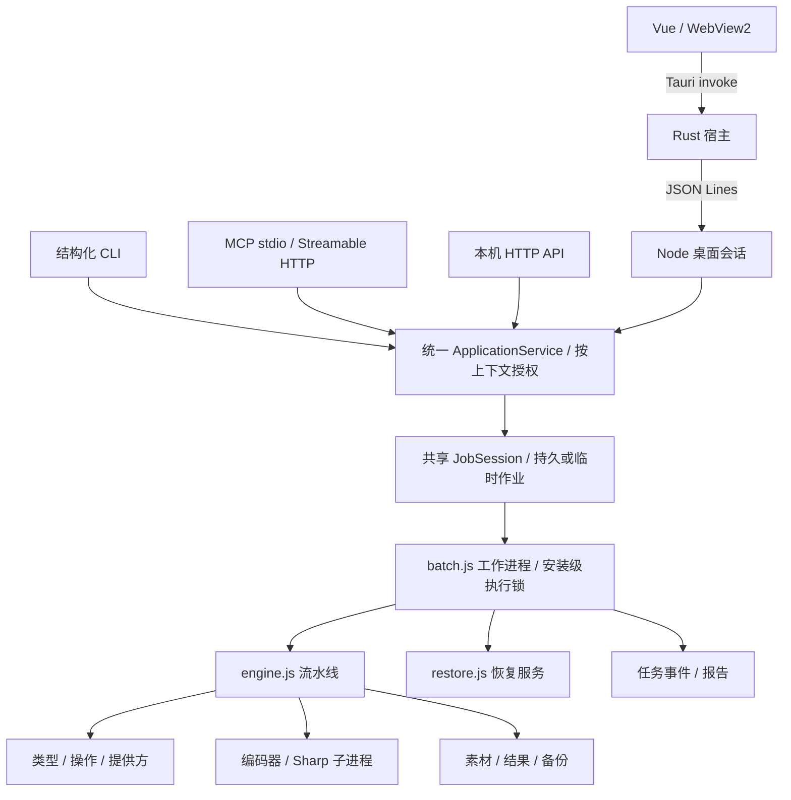

# 总体架构

AssetToolbox 1.0.0 是 Windows 便携资源处理工具，使用 Vue 3/TypeScript、Tauri 2/Rust、Node CommonJS。已支持三种格式压缩、PNG/JPEG 缩放，以及 WAV/FLAC/MP3/Ogg 分析、固定增益与响度归一化，处理采用有序步骤。提供结构化 CLI、stdio MCP 和按需启动的本机 HTTP API / MCP Streamable HTTP；没有云端服务、账户或数据库。

## 进程与边界

Rust 定位相邻 `runtime/node.exe` 和 `resource-core/`，开发模式可回退源码根目录；`spawn_blocking` 与 Mutex 处理阻塞管道。桥接转发到应用服务的本地桌面上下文，JobSession 启动作业、读取 status 并响应取消。Node 同步业务运行于工作进程；Sharp 的异步 API 在更短的子进程中执行。桌面和 stdio 启动不监听端口；单独启动 HTTP 服务时只绑定回环地址，E2E 显式启用本机 CDP。

## 代码职责

| 入口 | 职责 |
| --- | --- |
| `desktop/src/App.vue`、`core/workbench.ts`、`views/`、`components/` | 自绘标题栏、活动栏与状态栏，四个工作区、处理线与步骤编辑、全局作业栏、任务与恢复，见[前端架构](frontend.md) |
| `desktop/src-tauri/src/main.rs` | 本地宿主、目录对话框、报告打开、退出协作 |
| `desktop-bridge.js` | 桌面 JSON Lines 传输与应用服务委托 |
| `application/`、`../agent-mcp/` | 统一应用服务、桌面与受限 Agent 上下文、JobSession、HTTP API 及 MCP 双传输；见[自动化专题](automation.md)和[HTTP 专题](http.md) |
| `batch.js` | 预览/处理/续跑/恢复路由、锁、进度、报告 |
| `engine.js` | 扫描、有序步骤、结果策略、临时文件、统一提交 |
| `settings.js`、`tasks.js`、`restore.js` | 原子配置、任务日志、哈希恢复 |
| `framework/` 与三个扩展目录 | 发现、schema、进程执行及[扩展契约](extensions.md) |
| `framework/dependencies/` | 核验清单、下载/归档验证、不可变依赖安装与启用记录，见[依赖管理](dependencies.md) |

表中核心入口位于 `resource-core/`。Sharp 为核心唯一直接 npm 依赖；核心、桌面 npm 和 Rust 依赖各有锁文件。完整便携部署包含核心 node_modules，构建脚本通过便携 Node 验证 Sharp 可加载。

MCP 单独使用 SDK 2.4.0 与 Zod，不加入桌面核心依赖；按需携带 `agent-mcp/` 及其 node_modules。GUI 与 Agent 素材任务共用历史，实时作业面板仍属于各自会话。原生桥接 JSON Lines 与 MCP 是两个不同协议，不能互换连接。

## 数据流与安全

启动加载目录和配置，配置错误不妨碍任务/恢复入口。前端先 normalize，再保存配置（失败告警但允许本次运行），最后 start。预览不保存配置。批处理扫描后固定任务清单和规范化 pipeline，包括类型、操作、提供方和适配器版本。提供方 API 2 按操作组织适配器，依赖准备按提供方共享。

每个文件过滤适用步骤，按顺序执行；压缩接受更小输出，缩放接受合法输出。全部步骤成功后才做一次提交：写 intent、校验哈希、备份/排他创建或原子替换、写 result。后续步骤失败丢弃前面产物。续跑和恢复复用任务锁、哈希及事件日志；恢复不加载转换插件。

取消仅在扫描和文件边界检查；当前工具不被强杀。界面每 250ms 轮询，进程退出并释放锁后才显示最终 done。资源识别只按扩展名进入清单，再由类型/提供方验证内容；未知格式不复制。

同一用户、同一核心安装的作业共用系统临时执行锁，防止 GUI、CLI、MCP/HTTP 的新任务或依赖安装互相竞争；原任务锁保留。外部 Agent 经启动目录权限检查，转换默认另存，按幂等键提交，不改桌面设置。HTTP 请求断开不取消已提交作业，服务退出才请求取消；没有远程账户和常驻队列。

## 设计边界

当前只支持同格式、一入一出、逐文件串行；扩展为可信本地代码，无权限隔离、热重载、依赖注入。没有 Cordis。新数据根和 schema 不兼容历史数据，见[持久化](persistence.md)。后续扩展优先遵循契约，出现生命周期或服务依赖需求后再评估框架收益。
