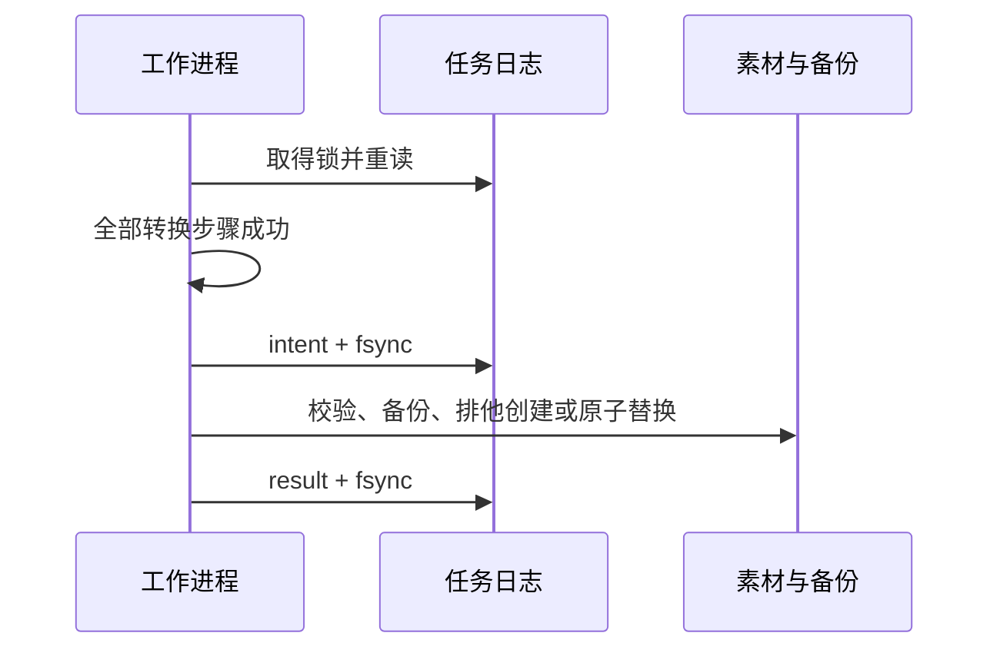

# 持久化与版本契约

源码：`resource-core/settings.js`、`tasks.js`、`batch.js`、`restore.js`。新项目不读写或迁移历史格式，参见 [ADR 0003](../decisions/0003-processing-contract.md)。

## 布局和配置

| 位置（相对 resource-core） | 用途 |
| --- | --- |
| `data/settings.json` | `schema: asset-toolbox.settings/1`，路径、保存方式和完整 pipeline |
| `data/tasks/<id>/task.json` | `schema: asset-toolbox.task/1`，固定任务头 |
| `data/tasks/<id>/events.jsonl` | 文件计划、提交及恢复事件 |
| `data/tasks/<id>/task.lock` 与 claim | PID/token 执行锁 |
| `data/reports/<id>/report.json`、`files.csv` | `schema: asset-toolbox.report/1` 报告及 CSV |
| 系统临时 `resource-desktop-*` | request/status/cancel，只属当前会话 |

全部 data、日志和个人路径不提交。缺少设置时只返回默认值，不创建文件；损坏或不支持 schema 时明确报错，不静默退回旧配置。保存先严格校验，再写同目录排他临时文件、fsync、rename；失败清理临时文件并保留旧内容。单文件配置替代原分散设置。

## 任务头和步骤快照

任务头含 id、createdAt、source、outputDir、backupDir、backupSession、pipeline。步骤包含 id、类型/操作/提供方 ID、enabled、两个参数对象及三层 versions。续跑/重试检查精确版本；不加载新界面参数，也不自动适配旧任务。版本由开发者维护，未对代码内容做哈希锁定。

plan 每个文件记录相对 path、resourceType、snapshot（size/mtimeMs/ctimeMs）。拒绝绝对路径、空段、`.`/`..`、冒号和空字符；恢复选择还拒绝 Windows 不区分大小写的重复路径。首次完整扫描后清单固定；扫描中取消则下次重扫。

## 事件和提交

| type | 作用 |
| --- | --- |
| plan | 完整清单，仅一次，条目 pending |
| intent | 写入前刷盘 sourceHash/expectedHash、备份信息及预期记录，条目 running |
| result | 处理结果 processed/skipped/failed/pending、resourceType、步骤记录及输出哈希 |
| restore-start | 开始恢复，此后禁止原任务续跑处理 |
| restore-selection | 固定显式恢复选择及预览哈希 |
| restore-result | restored/already-original/failed |

每个文件的全部转换步骤结束才写一次提交意图；不把中间产物作为已完成文件。步骤记录包含 id、operation、provider、status 及可用的字节数/metadata，失败记录 message。completed 只计 processed/skipped，失败和恢复数量独立统计。

## 锁和中断恢复

claim 登记后排他取得 PID/token 锁；只在确认进程退出且锁未变化时回收，释放仅删除 token 匹配的锁。持锁后重读任务，避免旧状态覆盖。读取仅重放完整换行事件；半行尾部在持锁后截断，完整坏记录报错。只读历史/预览不修复日志。

只有 intent 的记录根据磁盘哈希判定：目标等于 expectedHash 则补写完成（缺备份警告）；原文件未变、另存目标缺失或仍是原拥有副本则记失败待显式重试；其他内容/链接保留并记失败。另存重试只替换本任务拥有且未被修改的失败副本。

恢复使用原始备份与已提交目标哈希，不依赖转换提供方。已恢复文件后来被修改视为冲突；写完但恢复事件未落盘时按内容识别完成。不能把空 selection 转成省略或扩展恢复范围。

## 报告和边界

写操作生成报告，预览不生成。报告保存 pipeline 快照、逐文件结果、汇总、起止时间及任务摘要；CSV 为 UTF-8 BOM，引用与公式前缀安全转义。报告失败仅告警，不回滚结果。数据没有自动清理/压缩索引；大日志重放有成本。原子替换是单文件保证，不是整批事务。

验证：contract（原子配置/schema）、resume（锁/崩溃）、resize（步骤快照/版本/恢复）、restore/restore-preview（选择与哈希）、batch（报告）。
