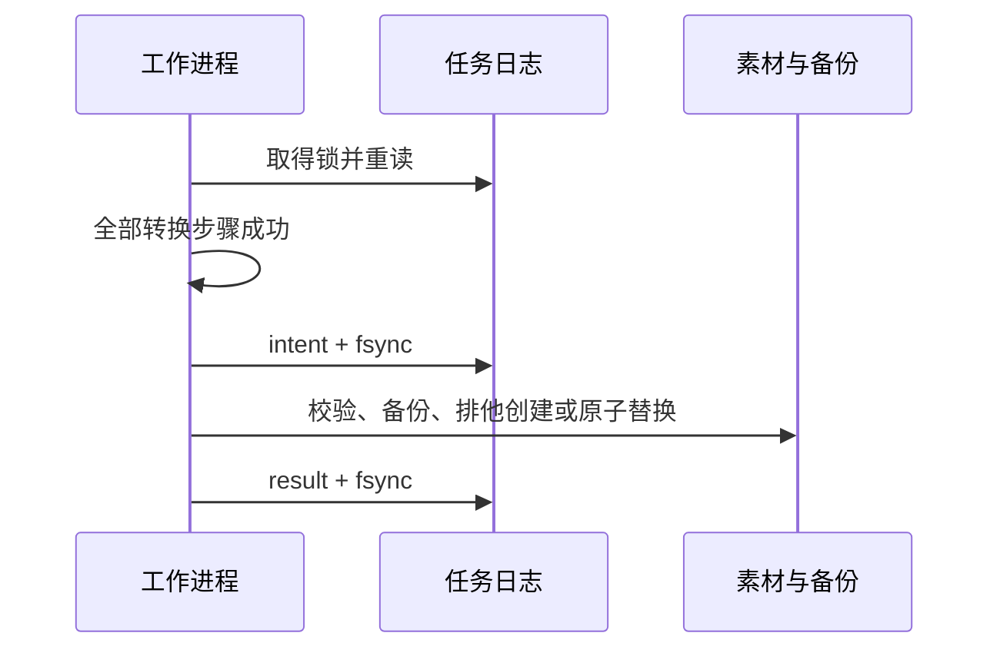

# 持久化与版本契约

源码：`resource-core/settings.js`、`tasks.js`、`batch.js`、`restore.js`。新项目不读写或迁移历史格式，参见 [ADR 0003](../decisions/0003-processing-contract.md)。

## 布局和配置

| 位置（相对 resource-core） | 用途 |
| --- | --- |
| `data/settings.json` | `schema: asset-toolbox.settings/2`，路径、保存方式和完整 pipeline |
| `data/tasks/<id>/task.json` | `schema: asset-toolbox.task/1`，固定任务头 |
| `data/tasks/<id>/events.jsonl` | 文件计划、提交及恢复事件 |
| `data/tasks/<id>/task.lock` 与 claim | PID/token 执行锁 |
| `data/reports/<id>/report.json`、`files.csv` | `schema: asset-toolbox.report/1` 报告及 CSV |
| `data/dependencies/<provider>/active.json`、`installs/<uuid>/` | `schema: 1` 受管理依赖启用记录与不可变副本，详见[依赖管理](dependencies.md)；不属于素材任务 |
| `data/jobs/v5/<jobId>/` | 全部入口的 `asset-toolbox.job/5`、请求/状态/进程记录及取消标记；上下文作用域与幂等键派生 jobId，见[统一应用接口](application.md) |
| 系统临时 `asset-toolbox-locks-<安装路径哈希>/` | GUI/CLI/MCP 执行互斥及提交锁，PID/token 与竞争声明；不改变只读预览的项目目录 |

全部 data、日志和个人路径不提交。缺少设置时只返回默认值，不创建文件；损坏或不支持 schema 时明确报错，不静默退回旧配置。保存先严格校验，再写同目录排他临时文件、fsync、rename；失败清理临时文件并保留旧内容。单文件配置替代原分散设置。

## 任务头和步骤快照

任务头含 id、createdAt、source、outputDir、backupDir、backupSession、pipeline。步骤包含 id、类型/操作/提供方 ID、enabled、两个参数对象及 `versions: {resourceType, operation, provider, adapter}`。续跑/重试检查完整且精确的四个版本；不加载新界面参数，也不自动适配旧任务。版本由开发者维护，未对代码内容做哈希锁定。

[ADR 0007](../decisions/0007-operation-adapters.md) 升级提供方契约后，配置 /1 明确拒绝，不重写旧文件；需重新建立 /2 配置。任务与报告外层 /1 保持不变，其步骤快照增加 adapter 版本；旧三字段快照或适配器版本变化会阻止继续处理。任务浏览及备份恢复只读取安全事件和哈希，不执行/迁移旧适配器，仍可恢复已有备份。

plan 每个文件记录相对 path、resourceType、snapshot（size/mtimeMs/ctimeMs）。拒绝绝对路径、空段、`.`/`..`、冒号和空字符；恢复选择还拒绝 Windows 不区分大小写的重复路径。首次完整扫描后清单固定；扫描中取消则下次重扫。

## 事件和提交

| type | 作用 |
| --- | --- |
| plan | 完整清单，仅一次，条目 pending |
| intent | 写入前刷盘 sourceHash/expectedHash、备份信息及预期记录，条目 running |
| result | 处理结果 processed/skipped/failed/pending、resourceType、步骤记录及输出哈希 |
| restore-start | 开始恢复，此后禁止原任务续跑处理 |
| restore-selection | 固定显式恢复选择及预览哈希 |
| restore-result | restored/already-original/failed |

每个文件的全部转换步骤结束才写一次提交意图；不把中间产物作为已完成文件。步骤记录包含 id、operation、provider、status 及可用的字节数/metadata，失败记录 message。completed 只计 processed/skipped，失败和恢复数量独立统计。

## 锁和中断恢复

claim 登记后排他取得 PID/token 锁；只在确认进程退出且锁未变化时回收，释放仅删除 token 匹配的锁。持锁后重读任务，避免旧状态覆盖。读取仅重放完整换行事件；半行尾部在持锁后截断，完整坏记录报错。只读历史/预览不修复日志。

只有 intent 的记录根据磁盘哈希判定：目标等于 expectedHash 则补写完成（缺备份警告）；原文件未变、另存目标缺失或仍是原拥有副本则记失败待显式重试；其他内容/链接保留并记失败。另存重试只替换本任务拥有且未被修改的失败副本。

恢复使用原始备份与已提交目标哈希，不依赖转换提供方。已恢复文件后来被修改视为冲突；写完但恢复事件未落盘时按内容识别完成。不能把空 selection 转成省略或扩展恢复范围。

## 报告和边界

写操作生成报告，预览不生成。报告保存 pipeline 快照、逐文件结果、汇总、起止时间及任务摘要；CSV 为 UTF-8 BOM，引用与公式前缀安全转义。报告失败仅告警，不回滚结果。数据没有自动清理/压缩索引；大日志重放有成本。原子替换是单文件保证，不是整批事务。

验证：contract（原子配置/schema）、resume（锁/崩溃）、resize（步骤快照/版本/恢复）、restore/restore-preview（选择与哈希）、batch（报告）。

## 音频观察与报告

[ADR 0008](../decisions/0008-audio-observation.md) 没有改变配置 /2、任务/报告外层 /1 的结构。新增操作与适配器照常固定四项 versions。新配置默认 saveAs，已有显式设置不自动迁移。只观察的文件有 plan/result 与 sourceHash，没有素材 intent、备份或输出；result 的文件状态为 skipped，步骤为 analyzed。

步骤 `metadata.audio` 保存 before/after 测量、增益、峰值限制及警告；失败步骤也可记录已测数据。report.json 的 audioResults 为本次处理的完整音频结果，额外生成 UTF-8 audio.csv；界面状态仅带前 100 条。失败文件所有音频步骤标记 fileStatus:failed，不表示已提交。CSV 沿用公式注入防护，报告写入失败不抹掉处理结果。

应用 /6 不读取或迁移旧 data/automation 作业；新存储中的 job/1–4 明确拒绝。预览也保留作业记录，但不创建素材任务或报告。当前没有自动清理作业记录；已完成作业可跨入口和重启查询，权限每次重新核验。

## 作业清理记录

当前应用/响应 /6 将清理记录写入 `data/jobs/v5/<jobId>/retention.json`，schema 仍为 asset-toolbox.retention/1；不改变 job/5、素材 task/report 和 settings 格式。清理前先写持久状态摘要和批准的文件清单；清理后保留作业身份、幂等键、进程退出记录及全部任务/备份，明细查询明确过期。未知 retention 版本拒绝读取，不迁移；部分清理失败只能继续处理清单中内容未变的文件。当前支持手动预览/选择，仍无自动清理和流式报告读取，详见[存储维护](storage.md)。

## FIFO 持久记录

job/5 位于 data/jobs/v5，保存 sequence、owner、publicRequest 及核心推导的 resources/1 读写集合；启动前写 dispatch/3 的 dispatch.json，并 fsync。旧 job/1–4 不读写/迁移。序号、身份及 dispatch 始终保留，不属于存储清理明细。未知启动声明版本拒绝。出队、取消、崩溃和退出语义见[队列](queue.md)。

dispatch/3 与 execution/2 同时保存稳定 slot；完成历史按硬上限 8 校验，活占用同时受当前预算约束。安装级 `data/scheduling.json` 使用 scheduling/1，仅含 schema 与 maxConcurrent，缺省 2、允许 1–8。提交锁加独占屏障确认全局空闲后临时文件 fsync/rename 原子替换；坏格式、链接、硬链接拒绝，不迁移。该文件不属于报告清理范围。
