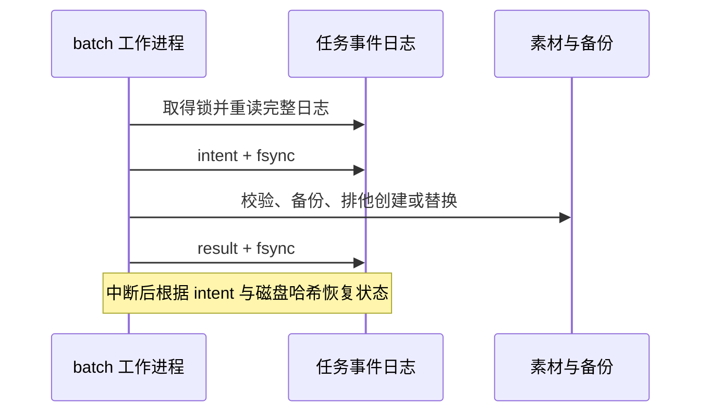

# 持久化与兼容性

项目没有数据库。配置、任务事件、报告和原始备份保存为普通文件；写入规则由 `settings.js`、`tasks.js`、`batch.js`、`compress.js` 和 `restore.js` 共同实现。用户数据不纳入 Git，但移动便携应用时应保留需要继续使用的配置、任务和报告。

## 文件布局

| 路径 | 生命周期与格式 |
| --- | --- |
| `resCompress/config/user-settings.json` | 公共配置 v2：源/输出/备份路径、保存模式、备份开关 |
| `resCompress/compressors/<id>/user-settings.json` | 模块配置 v1：本模块开关及参数 |
| `resCompress/user-settings.json` | 兼容旧的扁平 v1 配置，保存新布局后也不删除 |
| `resCompress/tasks/<id>/task.json` | 持久任务头 v1，固定原始参数与绝对路径 |
| 同目录 `events.jsonl` | 追加式事件日志，逐条换行并 fsync |
| 同目录 `task.lock`、`claim-*.lock` | 执行互斥与取锁协调，正常流程释放 |
| `resCompress/reports/<时间戳-UUID>/` | 每次写操作的 `report.json` 和 UTF-8 BOM `files.csv` |
| 用户指定目录下 `backup-<任务id>/` | 按源相对目录保存被替换文件的原始字节 |
| 系统临时目录 `resource-desktop-*` | `request.json`、`status.json`、`status.next`、`cancel`，不用于持久续压 |

模块定义 `config.js` 是源码；同目录 `user-settings.json` 是用户数据。二者不能混淆。任务和报告包含素材路径，不应作为测试夹具或公开样本直接提交。

## 配置读取与保存

内存配置仍是扁平 `version: 1` 对象。读取优先公共 v2；公共文件不存在才回退旧 v1，再叠加已安装模块自己的 v1 配置。公共文件损坏时公共字段退回默认值并告警；模块配置损坏仅重置该模块。加载、预览和普通关闭不触发迁移。

保存先校验完整配置，再为每个模块及公共文件生成临时文件并 fsync，依次 rename，公共配置最后提交作为迁移标志。可捕获错误会反向恢复已经替换的文件，回滚失败返回 `AggregateError`。这提供逐文件安全替换与失败补偿，不提供跨文件断电事务；不能宣称多个配置文件在任何进程中断下都同时更新。

## 任务头与文件条目

任务头保存 `version: 1`、`id`、`createdAt`、`source`、`outputDir`、`backupDir`、`backupSession`、`options`。路径使用规范化后的绝对路径，输出和备份不能同时设置；备份会话须为备份根目录下的 `backup-*` 子目录。

plan 为每个文件记录相对 `path`、所属 `module` 和 `snapshot {size, mtimeMs, ctimeMs}`。路径校验拒绝绝对路径、空段、`.`、`..`、冒号和空字符。选择性恢复还检查 Windows 下忽略大小写的重复路径及 SHA-256 格式。

## 事件模型

| type | 内容与作用 |
| --- | --- |
| `plan` | 完整扫描清单；只接受一次，建立 pending 条目 |
| `intent` | 提交前记录 sourceHash、expectedHash、输出/备份信息及预期状态；条目变 running |
| `result` | 文件最终记录，更新状态和已拥有输出哈希，清除 intent |
| `restore-start` | 标记开始恢复；此后禁止压缩续压与重试 |
| `restore-selection` | 持久化显式选择范围及预览哈希 |
| `restore-result` | 保存 `restored`、`already-original` 或 `failed` |

压缩状态为 pending → running → compressed/skipped/failed；running 只有在 intent 尚未对应 result 时存在。任务摘要中 completed 只统计 compressed/skipped，failed 独立，其他计入 pending。恢复摘要和压缩摘要分别计算，不能用恢复数量覆盖压缩完成数。

## 锁与日志修复

执行前用 claim 文件登记，再排他创建 `task.lock`，内容为 PID 和随机 token。检测到活跃持有者时拒绝；旧 PID 已退出且锁内容未变化时才回收。持锁后重新加载任务，避免用取锁前的旧内存状态覆盖新日志；释放时仅删除 token 匹配的锁。

加载只重放完整换行记录；崩溃留下的半行尾部忽略，持锁后截断。完整行中的坏 JSON、非法事件、无效路径会报错，不静默丢弃。只读历史浏览和恢复预览不取执行锁，也不修复日志。日志较大时每次重放存在内存与耗时成本，当前无索引、压缩或自动归档。

## 中断后的恢复判定

`recoverTask()` 对只有 intent 的文件核对当前磁盘 SHA-256：

- 当前目标等于 expectedHash：补写完成记录，避免重复编码；如备份丢失，保留完成状态并给出警告。
- 原文件仍为 sourceHash，或另存目标不存在/仍为此前拥有的副本：记为失败，交给显式重试，不自动重新编码。
- 当前文件为其他内容或路径含链接：记录失败并保留现状。

另存重试只允许替换已确认拥有且哈希未改变的失败副本。未确认完成的失败复制不能仅凭相同内容取得所有权。

恢复文件写完但 `restore-result` 未落盘时，下次按内容识别已等于原始备份，安全跳过重复写入。已记为恢复成功的文件后来又变化时保留当前内容，预览显示冲突，不重复恢复。

## 报告与兼容要求

`batch.js` 为压缩、续压、重试和恢复写操作生成 report v2；预览不生成报告。报告包含本次请求、参数、起止时间、逐文件结果、汇总，以及适用时的持久任务摘要、选择集或中断恢复记录。只列实际尝试的文件，不能把未处理项补成成功。

CSV 所有单元格加引号，双引号转义，可能被表格软件识别为公式的文本前加单引号。报告保存错误不会回滚素材，也不会抹掉已刷盘的任务日志。当前没有自动清理策略。

修改这些格式必须说明旧数据读取、版本处理、失败恢复与测试方案。不能只提升版本号而不实现迁移；也不能删除旧日志字段或重排事件语义来简化界面。恢复依赖 intent 中已有的原始/结果哈希，因此旧 v1 任务日志仍有恢复价值。

验证入口：`layout.test.js`（配置迁移与回滚）、`resume.test.js`（锁与 intent/result）、`restore.test.js` 和 `restore-preview.test.js`（恢复与选择快照）、`batch.test.js`（报告与状态）。
